<div align="center">



<br/>

<a href="https://discord.gg/2X9sUWq4NR"></a>
<a href="https://www.youtube.com/channel/UCU-LM6jYDoFRHL8WFzPp_-g"></a>
<a href="mailto:bedoflex777@gmail.com"></a>


</div>

<br/>

## `>` about

```lua
local bedoflex = {
    role     = "Backend & Frontend Developer",
    focus    = "FiveM resources — gameplay systems & NUI",
    studio   = "bedoflex Development",
    shipping = "Tebex · escrow-ready · fully configurable",
    style    = "modern · minimal · red",
}
```

## `>` scripts

<table>
  <tr>
    <td width="50%"><b>🔧 bedoflex Handling Studio</b><br/><sub>In-game vehicle handling editor with persistent saves and flexible permissions.</sub></td>
    <td width="50%"><b>⏸️ bedoflex Pause Menu</b><br/><sub>Modern, fully customizable pause menu.</sub></td>
  </tr>
  <tr>
    <td><b>🖥️ bedoflex Loading</b><br/><sub>Loading screen with image/video backgrounds and music.</sub></td>
    <td><b>🌾 bedoflex Farming</b><br/><sub>Farming system for roleplay servers.</sub></td>
  </tr>
  <tr>
    <td><b>🛡️ bedoflex Safezone</b><br/><sub>Configurable safe zones.</sub></td>
    <td><b>📦 bedoflex Airdrop</b><br/><sub>Airdrop events for your server.</sub></td>
  </tr>
  <tr>
    <td><b>🎭 bedoflex Animpos</b><br/><sub>Animation positioning tool.</sub></td>
    <td><b>🎙️ bedoflex Voice NUI</b><br/><sub>Clean voice HUD interface.</sub></td>
  </tr>
</table>

<p align="center"><sub>Docs, support & updates → <a href="https://discord.gg/2X9sUWq4NR"><b>Discord</b></a></sub></p>

## `>` stack

<p align="center">
  
</p>

## `>` stats

<p align="center">
  
  
</p>

<p align="center">
  
</p>

<div align="center">

<sub>© bedoflex Development</sub>
</div>
